# Ender 3 V3 SE — Club Printing Guide

> A step-by-step guide to preparing, transferring, and running your first print on the club's Creality Ender 3 V3 SE.

---

## Table of Contents

- [Overview](#overview)
- [Safety](#safety)
- [Printer Controls](#printer-controls)
- [Getting Started](#getting-started)
  - [1. Open the Model in Creality Slicer](#1-open-the-model-in-creality-slicer)
  - [2. Check PLA and Print Settings](#2-check-pla-and-print-settings)
  - [3. Slice and Inspect the Preview](#3-slice-and-inspect-the-preview)
  - [4. Save the Print File](#4-save-the-print-file)
  - [5. Transfer the SD Card](#5-transfer-the-sd-card)
  - [6. Load Filament](#6-load-filament)
  - [7. Level the Bed and Start the Print](#7-level-the-bed-and-start-the-print)
- [Monitoring the Print](#monitoring-the-print)
- [Finishing and Removing the Part](#finishing-and-removing-the-part)
- [Troubleshooting](#troubleshooting)
- [Checklist](#checklist)
- [References](#references)

---

## Overview

The workflow from model to finished print:

```
Object.STL → Slice → Handle.gcode → SD Card → Printer
```

The demonstration model is `Handle.STL` — a handle for a 5 GHz reflector dish.

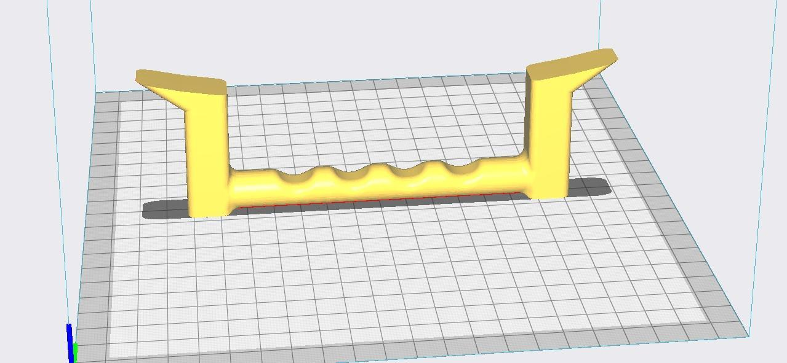
*The object shown in your slicer. The yellow color is the software preview; your supplied filament is white PLA.*

---

## Safety

> ⚠️ The nozzle and bed become very hot. The bed and print head move automatically. Know where the power switch is before starting.

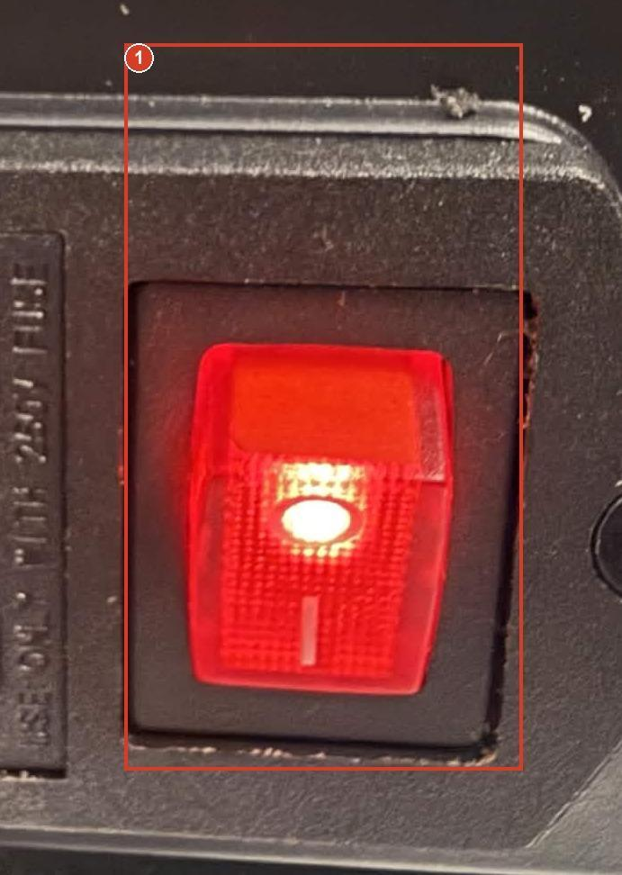
*Left side power switch. I means on; O means off.*

### Before Switching On
- Use the printer only in the club-approved, ventilated location
- Keep the bed travel area clear at the front and back
- Check the removable build plate is seated flat and the printing surface is clean (no greasy fingers)
- Check the spool turns freely and filament is not tangled
- Tie back long hair; keep sleeves, jewelry, and tools away from belts, fans, and the nozzle
- Do not touch the voltage selector, wiring, motion settings, or firmware — leave these to the instructor

### When to Stop
- **Loose print, scraping, or growing ball of plastic** → use **Stop** on the printing screen and tell the instructor
- **Smoke, sparks, or uncontrolled movement** → switch off at the side if safe, alert the instructor immediately, and follow the venue emergency procedure

Turn off only after the hotend has cooled with its fan running.

---

## Printer Controls

The printer is operated with the **rotary knob** below the screen. Turn to highlight, press to select, select **Back** to return.

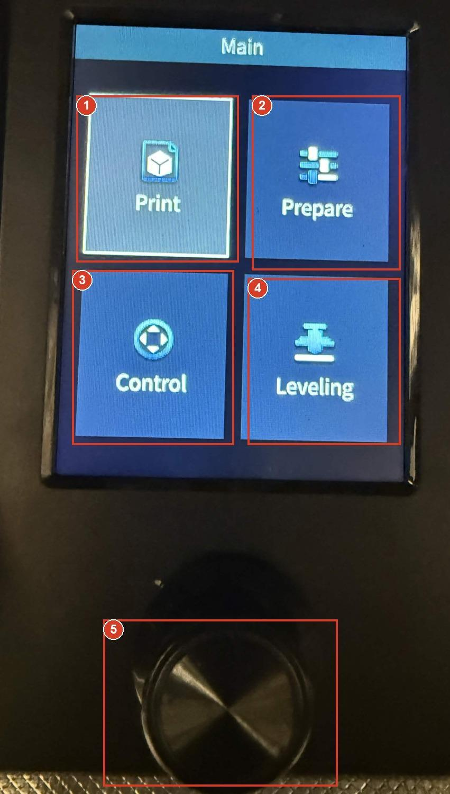
*Numbered controls on your printer. The outline on screen shows the current selection.*

| # | Control     | Function                                                |
|---|-------------|--------------------------------------------------------|
| 1 | Print       | Choose a G-code file from the SD card                  |
| 2 | Prepare     | Load or unload filament and access preparation tools   |
| 3 | Control     | Temperature and advanced settings (ask before changing) |
| 4 | Leveling    | Run automatic bed and nozzle-height calibration        |
| 5 | Rotary Knob | Turn to highlight; press to choose                     |

> **Note:** Temperature readouts show actual / target. For example, `21 / 0` means ~21°C now, with heating set to zero. Zero as the target does not guarantee the part is cool.

---

## Getting Started

### 1. Open the Model in Creality Slicer

Use **Creality Slicer 4.8**.

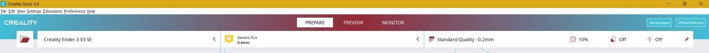
*Top bar: check the printer on the left, material and nozzle in the middle, and print settings on the right.*

1. Confirm the selected printer is **Creality Ender-3 V3 SE** (not V3 KE or another Ender model)
2. Go to **File > Open File(s)** (or `Ctrl+O`) and select `Handle.STL`

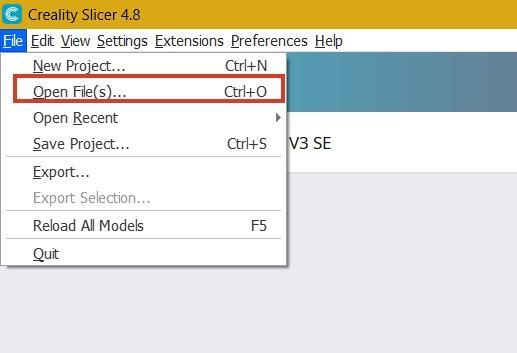
*Choose Open File(s) to import Handle.STL.*

3. Keep the scale at **100%** — do not resize to fit
4. Check the model is centered on the plate and the base touches it
5. Expected dimensions: **178.1 × 15.0 × 55.3 mm**

> ⚠️ Do not scale the handle — changing scale affects how it fits the dish.

---

### 2. Check PLA and Print Settings

The supplied filament is **Ender PLA, 1.75 mm, white**.

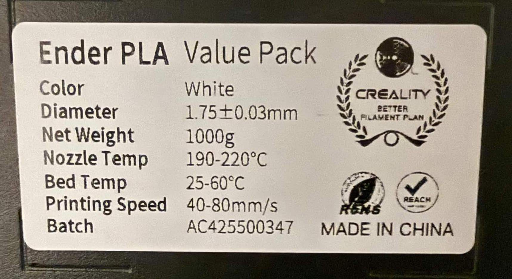
*Your spool label: nozzle 190 to 220°C, bed 25 to 60°C, printing speed 40 to 80 mm/s.*

| Setting              | Expected Value          | Notes                                           |
|----------------------|-------------------------|-------------------------------------------------|
| Printer              | Creality Ender-3 V3 SE  | Must match the actual machine                   |
| Material / Nozzle    | Generic PLA / 0.4 mm    | Instructor confirms nozzle size                 |
| Layer Height         | Standard Quality 0.2 mm | Use the approved demonstration profile          |
| Infill               | 10%                     | Demonstration only; strength needs approval     |
| Support              | Off                     | Instructor reviews raised ends and overhangs    |
| Build Plate Adhesion | Off                     | Instructor decides if a brim is needed          |

Also verify via **Custom Settings > Material and Speed**:
- Nozzle temp: **190–220°C**
- Bed temp: **25–60°C**
- Print speed: **40–80 mm/s**

---

### 3. Slice and Inspect the Preview

1. Click **Slice** at the bottom right and wait for it to finish


*Click Slice after checking the model and settings.*

2. Open **Preview** and use the layer slider to inspect the full model

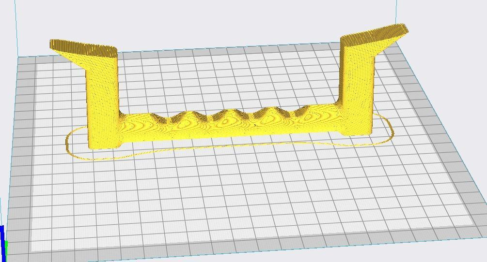
*Sliced handle in the supplied preview. Inspect the grip, upright ends, and the sloping top features.*

3. Check the first layer touches the bed and the handle stays within the plate
4. Look for missing sections, mid-air features, or overhangs that need support
5. Verify the estimate: approximately **2 hours 6 minutes**, ~**16g / 5.39m** of filament

> ⚠️ Get instructor approval before saving. Do not add support or rotate the part without guidance.

---

### 4. Save the Print File

Only the `.gcode` file goes on the printer:

| File                | Purpose                                 | Put on Printer? |
|---------------------|-----------------------------------------|-----------------|
| `Handle.STL`        | Original 3D shape (source model)        | No              |
| `HandleProject.3mf` | Editable slicer project                 | No              |
| `Handle.gcode`      | Sliced instructions for printer         | **Yes**         |

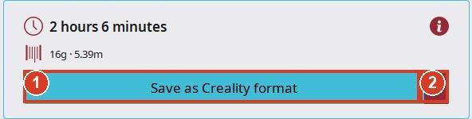
*1 Save the sliced result. 2 Open the save destination menu if a different destination is needed.*

**Steps:**
1. Click **Save as Creality format**
2. Choose **G-code (*.gcode)** as the file type
3. Use a short filename with no spaces — max **20 characters** (e.g. `Handle.gcode`)
4. Save to a known folder (e.g. `Documents > Club Prints`)

> ⚠️ Do not rename an `.STL` to `.gcode` — renaming does not slice the file.

---

### 5. Transfer the SD Card

**At the computer:**
1. Insert the SD card into the USB adapter and plug it into the computer
2. Open **File Explorer > This PC** and find the SD card drive
3. Copy `Handle.gcode` to the **card root** (outside all folders)
4. Confirm the filename and that the file size is greater than zero
5. Eject safely, then remove the SD card from the adapter

**At the printer:**

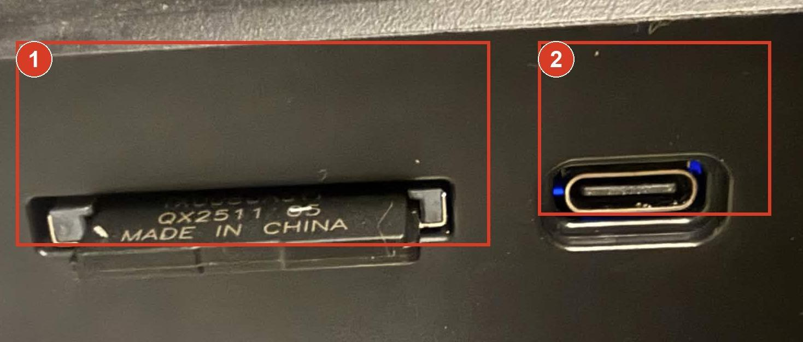
*1 SD-card slot. Insert the card here. 2 USB-C connector. The USB card adapter is not used here.*

6. Insert only the **SD card** (not the adapter) into the printer's SD slot
7. Insert gently — do not force it, and do not insert/remove while printing

**Card format:** FAT32 with 4096-byte allocation units (if reformatting is ever needed — instructor only).

---

### 6. Load Filament

If PLA is already loaded and feeding normally, leave it in place.

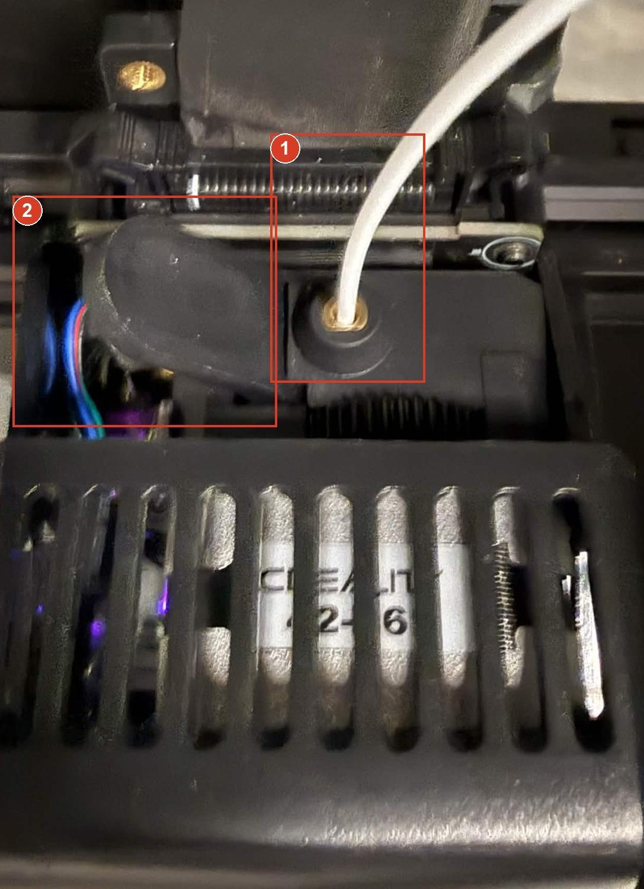
*1 Filament enters here. 2 Extruder release lever. Keep fingers above the hotend and away from fans.*

1. Mount the spool so it unwinds freely toward the print head
2. Cut the filament tip at ~45° and straighten the first few centimetres
3. On the main screen: **Prepare > Extrude**

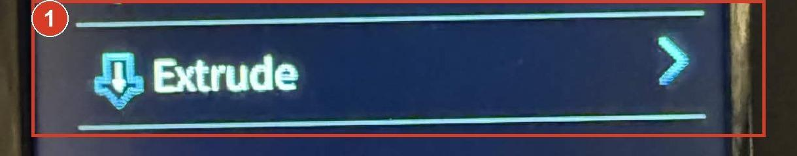
*Choose Prepare, then scroll to Extrude and press the knob.*

4. When prompted, press the release lever and feed filament into the inlet until the extruder grips it
5. Wait for a steady strand to come out of the nozzle — never touch the hot nozzle

**To remove filament:** Use **Prepare > Retract**, follow the prompts, and secure the loose end to the spool. Do not pull cold filament out by force.

---

### 7. Level the Bed and Start the Print

1. Choose **Leveling** on the main screen (for first print or when instructed)
2. Allow automatic heating, movement, and bed probing to finish — keep hands clear
3. Go to **Print**, turn to your exact filename, and press to select

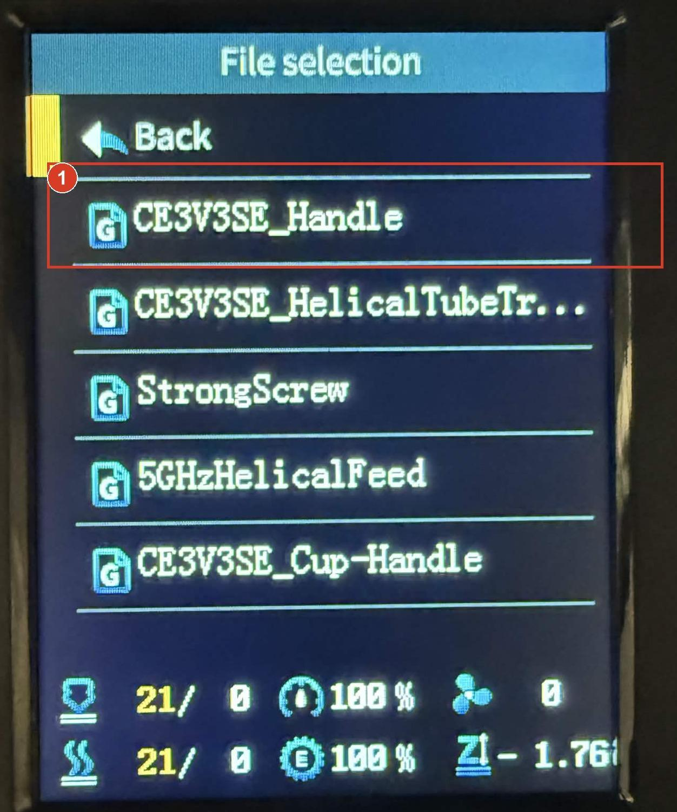
*The example already on the card is CE3V3SE_Handle.*

4. Watch temperature targets appear and the printer begin its start routine
5. Stay with the printer for the **first layer**

> ⚠️ Choose the file by its exact name, not its position in the list.

---

## Monitoring the Print

**A good first layer:** lines stay attached to the plate, sit next to each other with a slight flattening.

**Stop the print if you see:**
- Loose strands being dragged instead of sticking
- The nozzle scraping the plate or material not coming out
- A corner lifting or plastic collecting around the nozzle

Use **Stop** on the printing screen and confirm. Do not adjust Z-offset, speed, flow, or temperature without instructor guidance.

---

## Finishing and Removing the Part

1. Wait for the printer to report completion and stop moving
2. Let the nozzle and bed **fully cool** — check actual temperatures, not just targets
3. Hold the front tabs of the removable plate and lift it from the magnetic bed
4. **Gently flex** the plate to release the handle — do not force or gouge
5. Remove any brim or supports only after cooling, with approved tools
6. Clean the plate using the club-approved method and reseat it flat
7. Return the SD card as directed and record any problems
8. Switch off once the hotend has cooled (if club rules require it)

---

## Troubleshooting

| Problem | Action |
|--------|--------|
| Printer doesn't show the file | Check SD card (not adapter) is inserted; file must be `.gcode` at card root; try a shorter filename; check FAT32 format |
| Wrong file type saved | Re-open in Creality Slicer, slice, and save as `.gcode` — renaming won't work |
| Handle not sticking / lifting | Stop print; after cooling, have instructor check leveling, nozzle height, temperatures, and orientation |
| Extruder clicking / no output | Stop and ask instructor — do not force filament or touch the nozzle |
| Heating or probe error | Stop and report exact message; do not dismiss repeated warnings |
| Estimate doesn't match expected | Confirm settings match the approved profile and reslice |

---

## Checklist

### Prepare and Save
- [ ] Printer profile set to Ender-3 V3 SE; material matches loaded spool
- [ ] `Handle.STL` opened at 100% scale with correct placement and orientation
- [ ] Temperatures, nozzle size, speed, infill, support, and adhesion verified
- [ ] Sliced and Preview inspected; time and material estimate checked
- [ ] Saved as `Handle.gcode`; editable project saved separately

### Transfer and Start
- [ ] SD card inserted into USB adapter and connected to computer
- [ ] `Handle.gcode` copied to card root; filename and file size verified
- [ ] Card safely ejected; SD card removed from adapter
- [ ] SD card (only) inserted into idle printer
- [ ] Bed cleared, PLA loaded, leveling run if instructed
- [ ] Correct file selected by exact name; first layer supervised

### Finish
- [ ] Print completed; printer cooled with fan running
- [ ] Plate removed; part released gently; bed cleaned and reseated
- [ ] Faults recorded; tools stored; SD card returned

---

## References

- [Creality Ender-3 V3 SE User Guide](https://wiki.creality.com/en/ender-series/ender-3-v3-se)
- [Creality Ender-3 V3 SE Troubleshooting Guide](https://store.creality.com/uk/blogs/tutorial/ender-3-v3-se-troubleshooting-guide)
